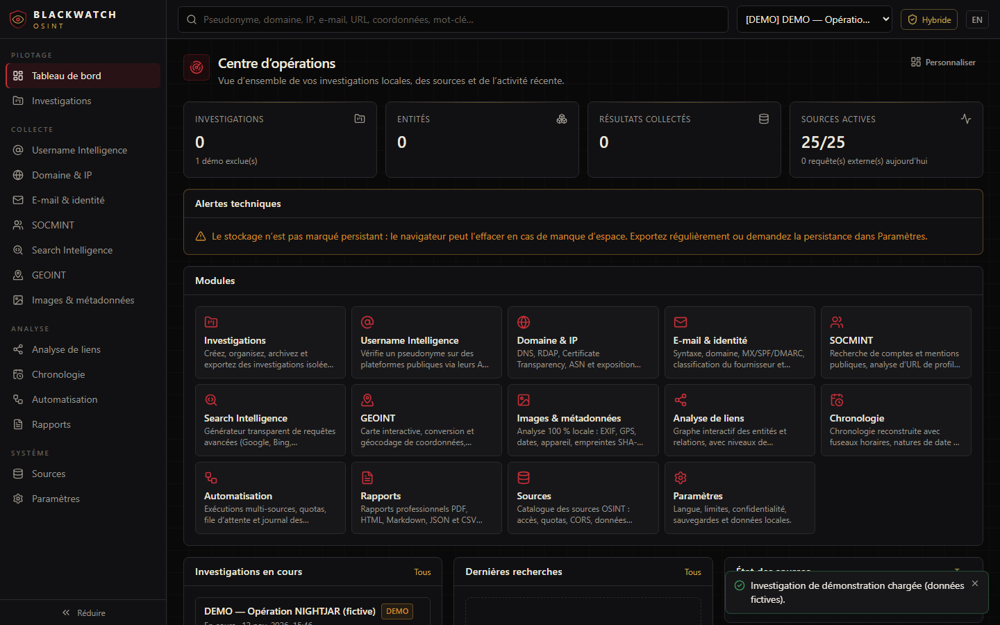
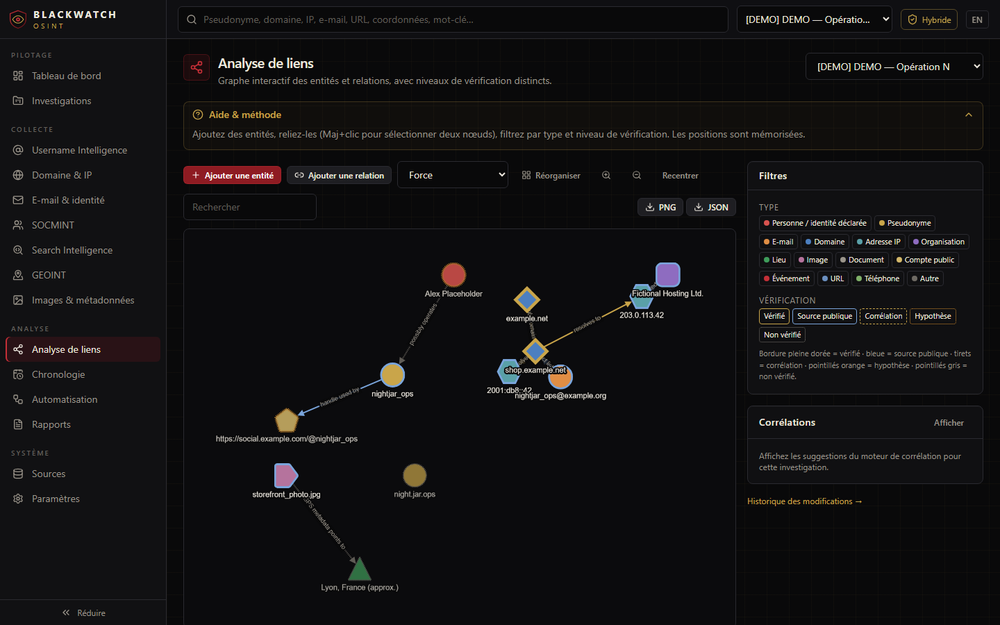
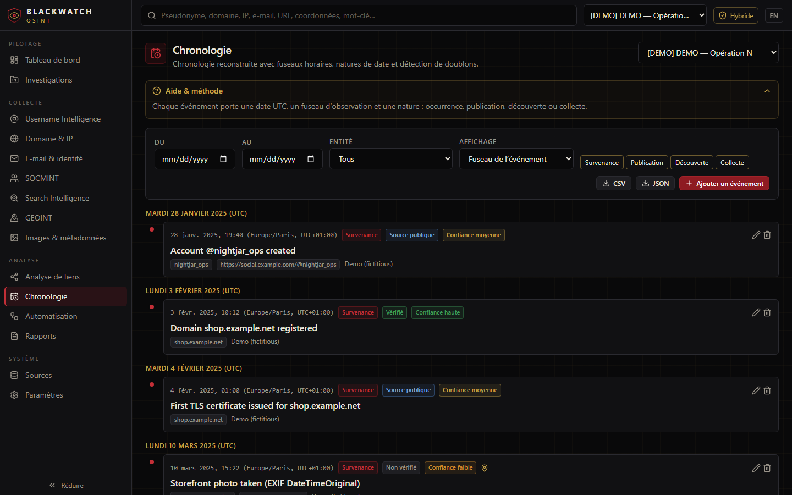

<div align="center">

# BLACKWATCH OSINT

**Plateforme d’investigation en sources ouvertes — 100 % frontend, hébergeable sur GitHub Pages.**
**Open-source intelligence investigation platform — 100% frontend, deployable on GitHub Pages.**

[Français](#français) · [English](#english) · Licence MIT · [Démo en ligne](https://intheshadowgp.github.io/BLACKWATCH-OSINT/)



</div>

---

## Français

### Présentation

BLACKWATCH OSINT est un outil d’investigation OSINT qui s’exécute entièrement dans le navigateur. Il n’a ni serveur, ni compte utilisateur, ni base de données distante. Les investigations restent dans IndexedDB, sur votre appareil. Les recherches externes passent uniquement par des sources publiques et gratuites, compatibles avec un navigateur, et chacune peut être activée, mise en mode manuel ou désactivée.

L’objectif n’est pas d’imiter un outil d’OSINT : BLACKWATCH est un outil d’investigation **fonctionnel, transparent et techniquement honnête**. Il n’invente aucun résultat et ne fait jamais passer une corrélation pour une certitude. Ce qui ne peut pas être automatisé depuis un navigateur est présenté comme tel, avec un lien officiel et une saisie manuelle.

### Fonctionnalités

| Module | Ce qu’il fait réellement |
|---|---|
| **Username Intelligence** | Interroge les API officielles de 11 plateformes (GitHub, GitLab, Codeberg, Bluesky, Mastodon, Hacker News, Keybase, DEV, Chess.com, Lichess, Wikipédia). Génère des variantes de pseudonyme et fournit les liens officiels de 16 autres plateformes, avec consignation manuelle du résultat. |
| **Domain & IP** | Résout les enregistrements DNS A/AAAA/MX/NS/TXT/CNAME/SOA/CAA/PTR et DMARC via DoH (Cloudflare, avec repli automatique sur Google). Interroge le RDAP du registre désigné par l’IANA, les sous-domaines via Certificate Transparency (Cert Spotter), l’ASN et le préfixe (RIPEstat), la géolocalisation approximative (IPinfo), l’exposition passive (Shodan InternetDB) et Wayback. Conserve l’historique des analyses. |
| **E-mail & identité** | Analyse localement la syntaxe et classe le fournisseur (webmail, alias, jetable…). Vérifie MX, SPF et DMARC, un éventuel profil Gravatar (seule une empreinte SHA-256 est envoyée) et propose des recherches ciblées. |
| **SOCMINT** | Recherche des comptes (Bluesky, Mastodon), des mentions (Hacker News), Wikipédia et Wikidata. Analyse les URL de profil, ouvre les recherches officielles de 18 plateformes et associe des comptes. |
| **Search Intelligence** | Constructeur transparent de requêtes avancées pour Google, Bing, DuckDuckGo et Yandex, qui signale les opérateurs non supportés. Inclut une bibliothèque de 23 modèles et des requêtes enregistrées. |
| **GEOINT** | Carte Leaflet/OSM. Convertit les coordonnées décimales ↔ DMS, géocode et géocode à l’envers (Nominatim, 1 requête/s, repli sur Photon). Importe CSV/GeoJSON, exporte GeoJSON/KML/CSV et associe un lieu à un événement. |
| **Images & métadonnées** | Analyse 100 % locale dans un Web Worker : EXIF/XMP/IPTC, GPS, dates, appareil, empreintes SHA-256/SHA-1. Vérifie le type MIME réel par signature, signale les indices (logiciel d’édition, dates incohérentes…) et exporte un rapport. |
| **Analyse de liens** | Graphe Cytoscape avec 14 types d’entités. Chaque niveau de vérification a son style visuel : vérifié, source publique, corrélation, hypothèse, non vérifié. Filtres, recherche, positions mémorisées, export PNG/JSON. |
| **Chronologie** | Dates en UTC avec fuseau IANA d’observation. Distingue occurrence, publication, découverte et collecte, détecte les doublons, exporte en CSV/JSON. |
| **Investigations** | Investigations isolées, statuts, archivage, notes, pièces jointes avec empreintes, historique des modifications. Export/import JSON, éventuellement chiffré en AES-256-GCM. |
| **Automatisation** | File d’attente et parallélisme contrôlé, quotas locaux par source, cooldown sur HTTP 429, relance individuelle, annulation, repli, déduplication. Journal de chaque requête sortante. |
| **Corrélation** | Le moteur tourne dans un Web Worker. Il propose correspondances exactes et partielles, doublons, incohérences et pistes. Toute suggestion acceptée reste au niveau « corrélation ». |
| **Rapports** | PDF, HTML, Markdown, JSON et CSV générés localement, avec la provenance de chaque élément. |

Autres fonctions : barre de recherche globale avec détection du type de valeur, tableau de bord personnalisable, interface bilingue FR/EN, mode démonstration fictif isolé, panneau de confidentialité par source.

<p align="center"> </p>

### Technologies

React 19 · TypeScript · Vite 8 · Tailwind CSS 4 · Lucide · Cytoscape.js · Leaflet · Dexie (IndexedDB) · Web Workers · Web Crypto API · Zod · exifr · jsPDF · Vitest · Playwright.

### Installation et lancement

Prérequis : Node.js 22 ou plus récent.

```bash
npm ci
```

```bash
npm run dev
```

L’application est alors servie sur `http://localhost:5173/`.

### Tests

```bash
npm test
```

Lance les tests unitaires, d’intégration et de sécurité (Vitest + fake-indexeddb).

```bash
npx playwright install chromium firefox
```

```bash
npm run test:e2e
```

Les tests de bout en bout tournent sur le **build de production** servi sous `/Blackwatch-OSINT/`. Ils vérifient le chemin de base, les assets, le routage, la CSP et l’absence de requêtes externes non autorisées.

```bash
npm run ci
```

Enchaîne typecheck, tests, scan de secrets et build.

### Déploiement sur GitHub Pages

1. Poussez le dépôt sur GitHub, sur la branche `main`.
2. Dans **Settings → Pages → Build and deployment**, choisissez **GitHub Actions** comme source.
3. Le workflow `.github/workflows/deploy.yml` lance l’audit npm, le typecheck, les tests, le scan de secrets, les tests E2E (Chromium et Firefox) et le build. Il ne publie qu’en cas de succès.

Le chemin de base est injecté automatiquement (`BASE_PATH=/<nom-du-dépôt>/`). Le routage utilise des URL à ancre (`#/…`), donc le rechargement d’une page fonctionne sans configuration serveur. Le déploiement passe par `actions/deploy-pages` : aucun commit de bot n’est créé.

### Sources OSINT

Le catalogue complet figure dans [docs/SOURCES.md](docs/SOURCES.md). Chaque source « API » a été testée par une vraie requête navigateur depuis une origine `localhost` le 2026-11-12. crt.sh, Reddit, Docker Hub et l’API CDX de Wayback ont échoué à ce test : ils sont proposés en lien manuel.

### Limites techniques

Voir [docs/API_LIMITATIONS.md](docs/API_LIMITATIONS.md). En résumé :

- Un site statique ne peut pas contourner CORS, ni utiliser une clé API privée, ni continuer à travailler une fois l’onglet fermé.
- Les quotas gratuits sont limités ; BLACKWATCH applique des budgets inférieurs aux limites publiées.
- X, Instagram, Facebook, LinkedIn, TikTok, Reddit et les moteurs de recherche ne sont pas automatisés. Ils sont proposés en liens officiels avec saisie manuelle.

### Confidentialité

Voir [docs/PRIVACY.md](docs/PRIVACY.md).

- Aucune télémétrie, aucun traceur, aucun compte.
- Une requête externe transmet la valeur recherchée et votre adresse IP au fournisseur concerné, et à lui seul.
- Les données ne sont **pas** chiffrées au repos dans IndexedDB. Les sauvegardes peuvent l’être.

### Sécurité

Voir [docs/SECURITY.md](docs/SECURITY.md).

- CSP stricte générée à partir du catalogue (`script-src 'self'`) et liste blanche d’hôtes par source.
- URL limitées à `http(s)`, échappement HTML/Markdown, neutralisation des formules CSV.
- Détection du type réel des fichiers par signature, validation Zod des imports, scan de secrets en CI.

### Contribuer

Voir [docs/CONTRIBUTING.md](docs/CONTRIBUTING.md). Guide utilisateur : [docs/USER_GUIDE.md](docs/USER_GUIDE.md). Architecture : [docs/ARCHITECTURE.md](docs/ARCHITECTURE.md).

### Usage responsable

BLACKWATCH n’offre **aucun accès privilégié** à des données privées. L’outil est destiné aux investigations autorisées, à la recherche, à l’enseignement et aux compétitions OSINT. Il ne contourne aucune authentification, protection anti-bot ou condition d’utilisation. Il ne recherche ni mots de passe ni identifiants. Respectez la loi applicable (RGPD notamment) et les conditions de chaque source.

### Licence

[MIT](LICENSE).

---

## English

### Overview

BLACKWATCH OSINT is an open-source intelligence investigation tool that runs entirely in the browser. It has no server, no user account and no remote database. Investigations stay in IndexedDB on your device. External lookups only use free, browser-compatible public sources, and each one can be enabled, set to manual or disabled.

The aim is a **working, transparent and technically honest** investigation tool, not a dashboard that looks like OSINT. Nothing is invented, and a correlation is never presented as a certainty. Anything that cannot be automated from a browser is shown as such, with an official link and manual recording.

### Features

The module table above applies, in short:

- **Username checks** on 11 platforms via official APIs, plus manual links for 16 others.
- **Domain/IP intelligence**: DoH, IANA-routed RDAP, Certificate Transparency, RIPEstat, IPinfo, Shodan InternetDB and Wayback.
- **E-mail analysis**: syntax, provider class, MX/SPF/DMARC and Gravatar via SHA-256 hash only.
- **SOCMINT**: account and mention search, profile-URL parsing, official platform searches.
- **Search Intelligence**: transparent advanced query builder for 4 engines.
- **GEOINT**: Leaflet/OSM map, rate-limited Nominatim, coordinate conversion, GeoJSON/KML.
- **Image analysis**: fully local EXIF/GPS/hash extraction in a Web Worker.
- **Link analysis**: Cytoscape graph with distinct styles per verification level.
- **Timeline**: UTC dates with observation time zone and date kinds.
- **Investigations**: isolated cases, optionally encrypted backups.
- **Automation engine**: quotas, 429 cooldown, fallback, request log.
- **Correlation**: Web Worker engine whose suggestions always stay suggestions.
- **Reports**: PDF, HTML, Markdown, JSON and CSV.

### Install, run, test, deploy

```bash
npm ci
```

```bash
npm run dev
```

```bash
npm test
```

```bash
npm run test:e2e
```

To deploy, push to `main` with **Settings → Pages → Source: GitHub Actions**. The workflow tests, builds with `BASE_PATH=/<repo>/` and deploys through `actions/deploy-pages`.

### Limitations, privacy, security

See [docs/API_LIMITATIONS.md](docs/API_LIMITATIONS.md), [docs/PRIVACY.md](docs/PRIVACY.md) and [docs/SECURITY.md](docs/SECURITY.md).

- Local data is **not** encrypted at rest; backups can be (AES-256-GCM).
- No telemetry.
- Only public sources, queried within their terms.

### Responsible use

BLACKWATCH provides **no privileged access** to private data. It is meant for authorised investigations, research, teaching and OSINT competitions. It never bypasses authentication, anti-bot protections or terms of service, and never searches for passwords or credentials.

### Licence

[MIT](LICENSE).
